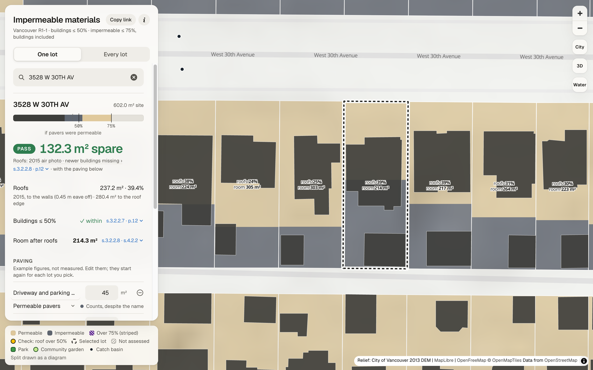
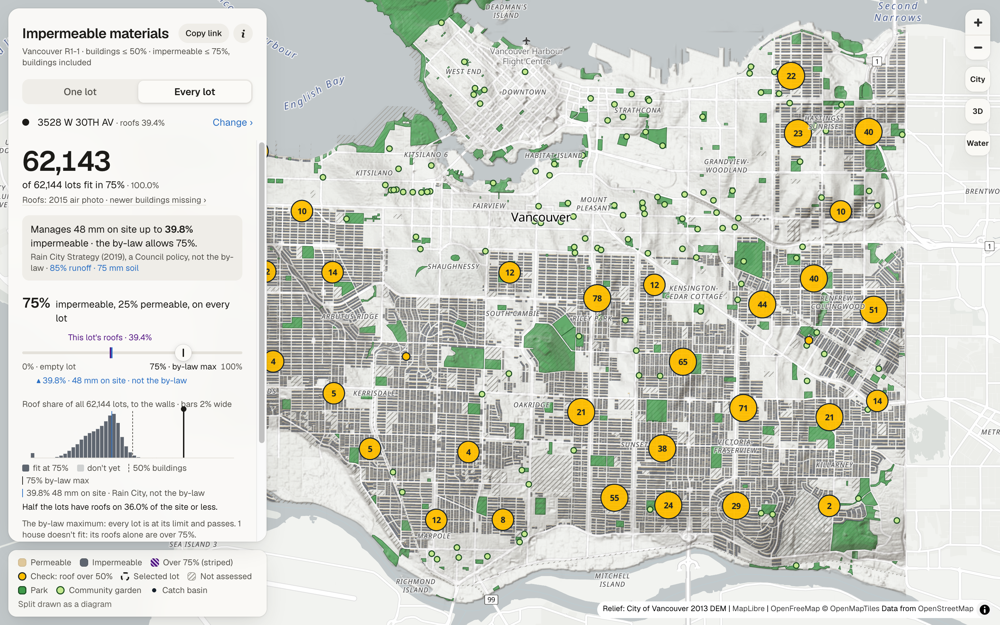
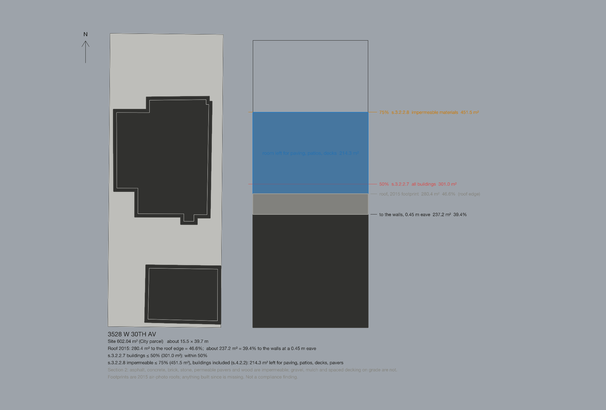
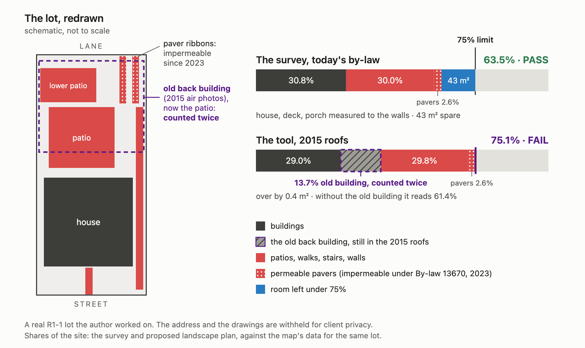

# Impermeable materials in Vancouver R1-1

**Live map: <https://kevinjinn6.github.io/arch540-impermeable-materials/>**

**ARCH 540 — Assignment 1, Making Design Knowledge Interactive**
Kevin Jinn · Instructor: Xun Liu · Phase 1, Weeks 1–4

## Purpose

This tool helps test the compliance for R1-1 homes to comply with the Vancouver
Impermeability Bylaw (Zoning and Development By-law No. 3575, R1-1 District Schedule
s.3.2.2.8 and the Section 2 definitions).
Designers can check the percentage of lots and see visual data about the
coverage of R1-1 roof sizes. It can help inform designers how much allowable
impermeable materials can be added to the landscape when they go to design the
lot while keeping in compliance with the Impermeability Bylaw. It also allows
you to take that lot and draw into rhino for 3d modelling of the landscape. It
also shows the amount of stormwater that the lots can hold, helping planners
evaluate the effectiveness of the impermeability law based on how much
allowable hardscape can be on a lot in response to climate change and Rain City
Strategy climate goals.

## How to use it

**In a browser.** Open the [live map](https://kevinjinn6.github.io/arch540-impermeable-materials/)
on a laptop (it works on a phone, but the panel is easier on a wide screen).
It needs an internet connection and loads about 8 MB of lot data, and the lot
card fills in once it has loaded, opening up on 3528 W 30th Ave. A short
introduction appears on a first visit; the **i** button in the panel's header
brings it back.

1. **Pick a lot.** Click a lot on the map, or type a civic address in the
   search box the City's way (`3528 W 30TH AV` is the default lot, with suggestions that appear as you
   type) and press Enter. The map flies to it and draws a dashed line around
   it. The card leads with the answer: a bar where the whole site is 100%,
   marked at 50% and 75% (dark is roof, slate is paving, sand is room left,
   striped purple is over the limit), then **PASS** or **FAIL** with the
   margin in square metres, and a reminder that the roofs come from the 2015
   air photo (click it for the assumptions). Under it: the 2015 roofs
   measured to the walls, the 50% buildings rule, and the room s.3.2.2.8
   leaves after the roofs. Tap any blue reference, such as
   *s.3.2.2.8 · p.12*, to read that passage in place.
2. **Fill in what else is on the lot.** Under *Paving*, three example
   surfaces are filled in (a driveway in permeable pavers, walks in concrete,
   a deck). They are examples, not measurements. Rename a surface by typing
   over its name, change its square metres, or pick its material from the
   list (named in the by-law's words). Each row says whether that material
   counts, with the page. **+ Add a surface** adds a row, the ⊖ button
   removes one (with *Undo* for a few seconds), and *Reset to the example*
   puts the three rows back. The bar, the PASS/FAIL and the lot on the map
   all update as you type. The pavers row reads *Counts, despite the name*,
   and a small dotted mark on the bar shows where the lot would sit if
   pavers were permeable. *Check the arithmetic* shows the sum so you can
   check it by hand. The schedule starts again for each new lot.
3. **Try the whole city.** Switch to **Every lot**. The slider sets the same
   impermeable share on every lot at once, from 0% (an empty lot) to 100%.
   The count above it is out of all 62,144 assessed lots: a lot fits once
   its 2015 roofs fit within that share (the 787 lots with no 2015 roof fit
   from 0%), and its house appears on the map. The mark at 75% is the by-law
   maximum; past it every lot shows a striped purple band for the share over
   the limit. The purple tick is the selected lot's own roof share. Under the
   slider, a histogram shows the roof share of every lot, with lines at 50%,
   75%, the Rain City point and the slider; the bars left of the slider are
   the lots that fit. *Change ›* goes back to pick another lot.
4. **See the storm water.** The line under the count gives the **Rain City
   point**: the share of hard surface at which a lot keeps a 48 mm rain day
   on site, sending nothing to the storm sewer (39.8%, against the by-law's
   75%). It is the same on every lot, because the lot's area cancels out:
   nothing overflows while 48 × (1 − h) + 0.85 × 48 × h ≤ 75 × (1 − h), so
   h = (75 − 48) ÷ (75 − 48 + 0.85 × 48). The blue mark under the slider moves
   it there. The two assumptions, 85% runoff and 75 mm of soil storage, can be
   changed on the page, with *Reset to defaults*. *48 mm storm* shows where
   the city's water goes at the slider, and *Storm* in a lot's card gives the
   point in square metres for that lot. This comes from the Rain City
   Strategy, a Council policy, **not the by-law**, and is labelled so
   wherever it appears.
5. **Share a view.** The page's address keeps the tab, the lot, the slider,
   any changed storm assumptions and any edited paving. *Copy link* in the
   header copies it; whoever opens it sees the same view.
6. **Other views.** Under the zoom buttons, *City* zooms out to the whole
   city, *3D* tilts the map over the 2013 ground with the 2015 buildings at
   their heights, and *Water* shows where rain runs and ponds once it leaves
   the lots (also not the by-law; its card explains the model). Parks,
   community gardens and street catch basins are drawn for context.
7. **Read the rule.** *The by-law, verbatim*, at the foot of the panel,
   quotes s.3.2.2.7, s.3.2.2.8, s.4.2.2 and the Section 2 definitions word
   for word, with their pages in the June 2026 consolidation, then the
   assumptions and the sources.

**Locally.** The page needs a small web server to load its data files:

```bash
cd map && python3 serve.py      # then open http://localhost:8000
```

(`python3 -m http.server` also works, but drops some of the 3D view's ground
tiles.)

**In Rhino 8.** Download or clone this repository (green **Code** button on
GitHub → *Download ZIP*, then unzip it). In Rhino 8 type `ScriptEditor` and
press Enter, open `map/rhino_site.py`, and near the top change
`ADDRESSES = ["3528 W 30TH AV"]` to the address(es) you want, spelled as in
the map's search box (the lot card's *Draw it in Rhino* row shows the exact
spelling). Press **Run**. The script reads `map/data/`, so keep the folder
together. It draws the site, its 2015 roofs
raised to their recorded heights, the eave allowance inside each roof, and an
*area bar* beside the site marked at 50% and 75%, with the room left for
paving. Named views `R1-1 map Plan - …` and `R1-1 map Axon - …` are saved. The
script draws only on layers under `R1-1 map` and touches nothing else. macOS
may refuse Rhino access to your Documents folder the first time ("Operation
not permitted"): allow it under **System Settings → Privacy & Security →
Files and Folders**, then run again.

**Regenerating the data.** The map reads a committed snapshot. To rebuild it
from City open data (no API key, and about 250 MB of downloads, a few minutes):

```bash
python3 -m venv .venv && source .venv/bin/activate
pip install -r requirements.txt
python stormwater.py          # R1-1 parcels            -> r11_stormwater.geojson
python buildings.py           # sites, 2015 roofs       -> map/data/lots.geojson, buildings.geojson
python map/roof_walls.py      # roofs to the walls      -> map/data/roof-walls.json
python map/park_lots.py       # empty park land, not assessed -> map/data/park-lots.json
python3 map/check_data.py     # the figures below still hold?
```

The shaded relief and the 3D ground come from the City's 2013 elevation model
(`DEM_2013.tif`, 1.9 GB, not committed; put it in the project folder):

```bash
python map/terrain_tiles.py   # relief and ground tiles   -> map/data/relief/, map/data/terrain/
python map/lot_ground.py      # ground under every lot    -> map/data/lot-ground.bin
python map/water_layers.py    # where the water goes      -> map/data/water.json, flow-paths, low spots
```

## Source

| Document | Version | Used |
|---|---|---|
| Zoning and Development By-law No. 3575, **R1-1 District Schedule** (`sources/zoning-by-law-district-schedule-r1-1.pdf`) | June 2026 consolidation, 17 pp. | s.3.2 and s.3.2.2.1 (p.12), **s.3.2.2.7** and **s.3.2.2.8** (p.12), s.2.2.4 (p.5), **s.4.2.2** (p.16) |
| Zoning and Development By-law No. 3575, **Section 2 Definitions** (`sources/zoning-by-law-section-2.pdf`) | June 2026 consolidation, 50 pp. | **Impermeable Materials** (p.20), **Permeable Materials** (p.31), Deck (p.11), Patio (p.30), Site (p.43) |
| City of Vancouver open data | property parcel polygons (retrieved 2026-09-21), building footprints 2015 and 2009 (2026-09-25) | site outlines and areas, roof footprints, heights for the Rhino drawing only |
| City of Vancouver open data | 2013 digital elevation model; parks, community gardens, catch basins (2026) | the shaded relief, the 3D ground and the Water view; context only, in no compliance figure |
| Rain City Strategy (2019) | Council policy, **not a by-law** | the 48 mm daily design standard in the storm card and the Rain City point, as context |

Every passage is quoted verbatim, with its page, in
[`sources/r1-1-impermeable-extract.md`](sources/r1-1-impermeable-extract.md),
which also records each interpretive decision and what remains unresolved.
The register of all documents, with retrieval dates and authority levels, is
[`sources/README.md`](sources/README.md).

## One example

3528 W 30th Ave, a real 602.04 m² R1-1 lot (City parcel R11-042685), as the
map opens on it:

| | | Source |
|---|---:|---|
| Site area, City parcel | 602.04 m² | parcel polygon |
| Roofs, 2015 footprints, to the roof edge | 280.4 m² · 46.6% | footprints clipped to the site |
| Roofs to the walls (0.45 m eave taken off) | 237.2 m² · 39.4% | the by-law measures walls, Section 2 p.20 |
| s.3.2.2.7 buildings ≤ 50% = 301.0 m² | within | p.12 |
| s.3.2.2.8 impermeable ≤ 75% = 451.5 m², buildings included | **214.3 m² of room** after the roofs | p.12, s.4.2.2 p.16 |
| With the illustrative schedule: 45 m² of permeable pavers, 25 m² of concrete, 12 m² of tight-board deck | 319.2 m² · 53.0% · **PASS**, 132.3 m² spare | Section 2 p.20 |
| If permeable pavers were permeable (they are not) | 45.5% | — |

Check by hand: 0.75 × 602.04 = 451.53; 451.53 − 237.22 = 214.31 m².

Citywide, across all 62,144 assessed lots: at the 75% by-law maximum,
62,143 lots fit (one lot's roofs alone are over 75%). At the Rain City point,
39.8%, 42,556 lots fit, 68.5%: for the other 19,588, the roofs alone already
cover more of the site than a lot can have and still keep a 48 mm rain day on
site. Half the lots have roofs on 36.0% of the site or less. 787 assessed lots
have no roof in the 2015 footprints and count as 0% roofs.

**Input:** search `3528 W 30TH AV`; leave the example paving as it is.
**Result:** PASS, 132.3 m² spare. The selected lot on the map shows the same
split as its bar.



The same lot in *Every lot* with the slider at the 75% by-law maximum:
62,143 of 62,144 lots fit, the purple tick is this lot's roofs at 39.4%, and
the blue mark is the Rain City point at 39.8%.





In Rhino, the **area bar** beside the site is a copy of the site as a bar: the
same width, the same area, so its depth is 100% of the site. Dark is the roof
to the walls, grey the eave strip, blue the room left under 75%.

## A real lot: the tool against a survey

The map was also tried on a real R1-1 lot the author worked on, against its
survey and the proposed landscape plan. The address and the drawings are
withheld for client privacy; the diagram is a schematic redraw.



| Share of the site | Survey, today's by-law | The tool |
|---|---:|---:|
| Buildings | 30.8% (surveyed walls) | 42.7% (2015 roofs to the walls) |
| Patios, walks, stairs, walls | 30.0% | 29.8% |
| Permeable-paver ribbon driveway | 2.6% | 2.6% |
| **Total** | **63.5% · PASS** | **75.1% · FAIL**, by 0.4 m² |

Why they differ:

- **The 2015 roofs are out of date.** The air photos show a back building
  that has since been replaced by the new patio, so the tool counts that
  ground twice: once as roof (13.7% of the site) and once as the patio
  entered in the schedule. Without it the tool reads 61.4%.
- **Permeable pavers changed sides.** The plan was drawn before By-law 13670
  (April 2023) added permeable pavers to *Impermeable Materials*, so it left
  the ribbons out and totalled 60.8%. Both columns above count them, as the
  by-law does today.
- What remains (61.4% against 63.5%) is roof edge less a 0.45 m eave against
  surveyed walls, and the City parcel against the surveyed site area.

The tool is a first screen; the survey decides.

## Skill and limits

**Skill.** [`skill/SKILL.md`](skill/SKILL.md) is a reusable procedure for
reading any R1-1 lot off this map and the by-law: what to look up, what the
numbers mean, which assumptions to say out loud, and how to check a figure
against the source by hand.

**What the tool does not do, and where a person must check:**

- **Roofs are 2015 air-photo footprints.** Anything built or demolished since
  is wrong here. They follow the roof edge, and the by-law measures walls, so a
  0.45 m eave allowance is taken off for the by-law test and both figures are
  shown. Measured to the roof edge 13,581 assessed sites read over 50%,
  measured to the walls, 769. The air photo cannot tell which is right for
  any one house, so those 769 are marked *check*, not *exceedance*. 787
  assessed lots have no 2015 roof at all (empty, or between a teardown and a
  new house, when the photo was taken); they count as 0% roofs.
- **Driveways, patios and walks are in no City dataset.** The lot schedule
  and the slider are hypotheses you set, they are not a survey of existing
  paving. The page is not a compliance finding.
- **It checks s.3.2.2.7 and s.3.2.2.8** for uses under s.3.2 (single detached
  house, duplex and others not regulated by s.3.1). A multiplex under s.3.1
  has no impermeable-materials limit. Laneway houses are regulated by
  Section 11 (s.2.2.4), which is not in this repository, the map counts them
  as buildings.
- **A site is parcels sharing an address and an edge** (Section 2, Site).
  Sites over 2,000 m², road allowances, parcels under 150 m², parcels the
  pipeline flagged and park land with no building are hatched and not
  assessed. Parcels below the 306 m²
  minimum site area of s.3.2.2.1 are assessed but labelled.
- **Two readings are the author's**, and the page says so where it relies on
  them: the on-grade, no-impermeable-layer condition applied to every listed
  permeable material, a raised deck (a *Deck* is over 600 mm, Section 2 p.11)
  counted as wood, so impermeable.
- **The split drawn inside each lot is a diagram**, a share of the lot's
  depth from the south edge, not where the surfaces are.
- **The storm card and the Rain City point are Rain City Strategy context**,
  not the by-law. The R1-1 schedule sets no retention requirement: 85% runoff
  and 75 mm of soil storage are this page's assumptions (they can be changed
  on the page). "On site" means nothing reaches the storm sewer; the 15% of
  rain on hard surfaces that does not run off stays where it falls.
- **The relief and 3D ground are pictures** from the 2013 elevation model,
  cut to the city boundary; no figure uses them. Outside the city the 3D
  ground is invented, a smooth surface easing down to sea level.
- **Colours are checked for colour blindness** (simulated protanopia,
  deuteranopia and tritanopia), and *over 75%* is striped as well as purple.
- It cannot know what the Director of Planning will accept as permeable.

## Reviews and revision

Three outside reviews of the live map, written cold on 2026-10-02, are in
[`docs/reviews/`](docs/reviews/): a permit-practice review, a studio-crit
review and a computational review.
[`docs/review-response-map.md`](docs/review-response-map.md) lists every
finding, what changed in response, and what was left as the author's decision.
Peer reviews from class are GitHub issues on this repository.

---

## Repository map

```
README.md                     you are here
map/
  index.html                  THE TOOL: the map, one lot's card and schedule, the citywide slider
  water.js                    the Water view: where rain goes once it leaves the lots
  serve.py                    local web server for the map (python3 serve.py)
  rhino_site.py               draws any lot from the map's data in Rhino 8
  roof_walls.py               roof area to the walls per site -> data/roof-walls.json
  park_lots.py                empty park land zoned R1-1, not assessed -> data/park-lots.json
  terrain_tiles.py            shaded relief and 3D ground from the 2013 DEM -> data/relief/, data/terrain/
  lot_ground.py               ground height under every lot corner, for 3D -> data/lot-ground.bin
  water_layers.py             flow paths and low spots for the Water view -> data/water.json, ...
  check_data.py               smoke test of the data files; run by the Pages workflow
  data/                       the published snapshot: lots, buildings, roofs to the walls, parks,
                              gardens, catch basins, relief and terrain tiles, water
buildings.py                  the pipeline: parcels -> sites, 2015 roofs clipped and summed
stormwater.py                 Stage 1: finds the R1-1 parcels (and a citywide stormwater analysis)
requirements.txt              pinned versions for the pipeline
skill/SKILL.md                the reusable skill
sources/
  README.md                   source register: version, authority, retrieval date
  r1-1-impermeable-extract.md the passages verbatim, with pages; decisions; hand-worked examples
  *.pdf                       the by-laws themselves
output/                       Rhino captures of the example lot
docs/
  regulation-shortlist.md     preferred source + two ranked alternatives, argued (W1)
  prompt-comparison.md        W1 exercise: what changed between two prompt approaches
  reviews/                    outside reviews, 2026-10-02
  review-response-map.md      what changed in response, finding by finding
tool/                         a companion single-lot checker for the same provision: surfaces
                              named in the by-law's words, clipped to the lot, overlaps counted
                              once; terminal, web page and Rhino. See tool/impermeable_check.py.
week-01/                      the two W1 prototypes (evidence for the prompt comparison)
.github/workflows/pages.yml   publishes map/ to GitHub Pages after map/check_data.py passes
```

## Precursor: the citywide stormwater analysis

`stormwater.py` also runs a gap analysis across all R1-1 parcels against the
Rain City Strategy's 48 mm design storm. It is where this project started and
where the map's storm card comes from. Read the caveats in its file header
before quoting any number from it; the most important is that **48 mm is not
a legal requirement for R1-1**. Its large outputs (`r11_stormwater.geojson`,
`r11_stage2.geojson`, `cache/`) are not committed and are regenerated by the
commands above.

## Not in this repository

- `.venv/`, `cache/`, the two large GeoJSON intermediates — recreated by the
  commands above.
- The surveyed site plan used for real-world testing. It is a client drawing
  and is held back pending permission. The example lot is a real parcel
  carrying an illustrative schedule, so the tool can be run by anyone.
